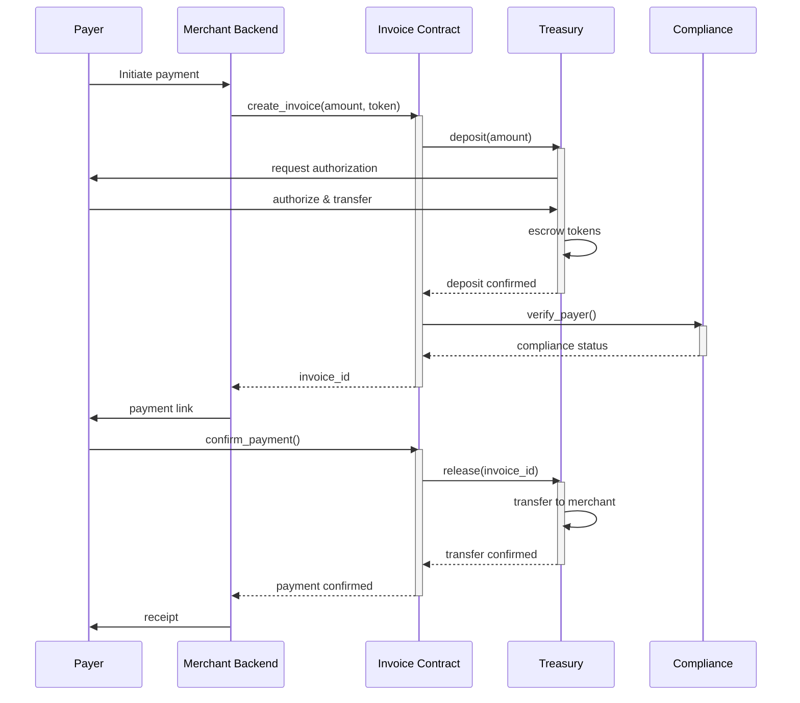

# COMEBACKHERE Protocol

> **The Stripe for Stellar**
> Secure, scalable, and developer-friendly payment infrastructure built on the Stellar network.

This repository contains the tooling, deployment scripts, contract ABIs, documentation, and integration resources required to develop, deploy, and maintain the **COMEBACKHERE Protocol**.

---

## Overview

COMEBACKHERE provides the infrastructure needed to build seamless payment experiences on Stellar. This repository serves as the central workspace for:

* Smart contract deployment
* ABI generation and management
* Developer documentation
* Local development tooling
* Integration and deployment scripts
* Workspace-level testing

---

## Typed API Client

The backend publishes an OpenAPI schema at `docs/openapi.yaml`. A typed client
is generated from that schema so request and response types stay synchronized
with the published API.

### Generate the client

```bash
npm run generate:client
```

This regenerates the client into `packages/api-client/` from
`docs/openapi.yaml`. Do not edit generated files by hand — change the spec and
regenerate.

### CI staleness check

CI runs `npm run generate:client` and fails if the regenerated output differs
from what is committed. If the check fails locally, regenerate and commit the
result:

```bash
npm run generate:client
git add packages/api-client
git commit -m "chore: regenerate API client"
```

### Consumer example

```typescript
import { createClient } from "@comebackhere/api-client"

const client = createClient({
  baseUrl: "http://localhost:3000",
  apiKey: process.env.MERCHANT_API_KEY,
})

// Request and response types are derived from the OpenAPI schema.
const invoice = await client.createInvoice({
  token: "USDC",
  amount: 1000000,
  due_date: 1720000000,
})

console.log(invoice.invoice_id)
```

> Full request/response shapes: [docs/api-reference.md](docs/api-reference.md)

---

## Quickstart for Merchants

Integrate COMEBACKHERE payments in three steps: create an invoice, set up
webhooks, and process the payment. This section links to the full reference
docs rather than duplicating them.

### 1. Create an invoice

```bash
curl -X POST http://localhost:3000/invoices \
  -H "Content-Type: application/json" \
  -H "Authorization: Bearer $MERCHANT_API_KEY" \
  -d '{
    "token": "USDC",
    "amount": 1000000,
    "due_date": 1720000000
  }'
```

The response includes `invoice_id` — share this with your payer.

> Full request/response shapes: [docs/api-reference.md](docs/api-reference.md#post-invoices)

### 2. Set up webhooks

Configure `WEBHOOK_URL` and `WEBHOOK_SIGNING_SECRET` in your environment so
the backend can notify your system when payments land.

All outbound webhook POSTs are signed with HMAC-SHA256 over the exact raw body
bytes. Verify the `X-COMEBACKHERE-Signature` header before processing:

```typescript
import { createHmac, timingSafeEqual } from "crypto"

function verifyWebhook(rawBody: string, signature: string, secret: string): boolean {
  const expected = createHmac("sha256", secret).update(rawBody, "utf8").digest("hex")
  const expectedBuf = Buffer.from(expected, "hex")
  const actualBuf = Buffer.from(signature, "hex")

  // timingSafeEqual throws on a length mismatch, so reject short or
  // malformed signatures before comparing.
  if (expectedBuf.length !== actualBuf.length) return false
  return timingSafeEqual(expectedBuf, actualBuf)
}
```

The body-only digest is temporarily available as `X-COMEBACKHERE-Legacy-Signature`
for one release while receivers migrate.

> Webhook events and configuration: [docs/api-reference.md](docs/api-reference.md#webhooks)

### 3. Minimal payment flow

```text
Merchant            Backend              Payer
  |                   |                    |
  |-- create_invoice ->|                    |
  |                   |                    |
  |  (share invoice_id with payer)         |
  |                   |                    |
  |                   |<-- pay off-chain ---|
  |                   |                    |
  |<-- webhook POST --|                    |
  |  (settlement_executed)                 |
```

For the full end-to-end testnet walkthrough (funding accounts, deploying
contracts, paying with USDC, and executing a settlement), see
[docs/TESTNET_ONBOARDING.md](docs/TESTNET_ONBOARDING.md).

> Rate limits apply to all API endpoints. See [docs/rate-limits.md](docs/rate-limits.md).

---

## Seeded Local Testnet Merchant Walkthrough

This walkthrough seeds a repeatable merchant scenario (merchant, invoice, and
settlement) against a local testnet so a clean environment can verify both the
on-chain and backend state end to end.

### Prerequisites

* Docker and Docker Compose
* Node.js 20+ and `npm`
* A clean checkout (no prior local state)

### 1. Start a clean stack

```bash
# Tear down any previous state so the walkthrough is repeatable.
docker compose down -v

# Bring up the local testnet, backend, and dependencies.
docker compose up -d
```

Wait for the backend health check to pass:

```bash
curl -fsS http://localhost:3000/health
```

### 2. Seed the merchant scenario

The seed script provisions a deterministic merchant, funds its account, and
creates a known invoice. It is idempotent — re-running it resets the scenario
to the same known state.

```bash
npm run seed:testnet
```

This writes the seeded identifiers to `.env.testnet` (merchant API key,
`MERCHANT_ID`, `INVOICE_ID`, and contract IDs). Source it for the steps below:

```bash
set -a && . ./.env.testnet && set +a
```

### 3. Create and pay the invoice

```bash
# Create the invoice (or reuse the seeded INVOICE_ID).
curl -X POST http://localhost:3000/invoices \
  -H "Content-Type: application/json" \
  -H "Authorization: Bearer $MERCHANT_API_KEY" \
  -d '{"token":"USDC","amount":1000000,"due_date":1720000000}'

# Pay the invoice from the seeded payer account.
curl -X POST http://localhost:3000/invoices/$INVOICE_ID/pay \
  -H "Authorization: Bearer $MERCHANT_API_KEY"
```

### 4. Observe settlement

```bash
curl -fsS http://localhost:3000/invoices/$INVOICE_ID \
  -H "Authorization: Bearer $MERCHANT_API_KEY"
```

Expect `status: "settled"` and a populated `settlement_tx_hash`.

### 5. Verify expected state

**Backend state (API/DB):**

```bash
# Invoice is settled and linked to the seeded merchant.
curl -fsS http://localhost:3000/invoices/$INVOICE_ID \
  -H "Authorization: Bearer $MERCHANT_API_KEY" | jq '.status, .merchant_id'

# Confirm the settlement record exists in MongoDB.
docker compose exec mongo mongosh --quiet --eval \
  'db.settlements.findOne({invoice_id: "'"$INVOICE_ID"'"})'
```

**On-chain state (contract/ledger):**

```bash
# Confirm the invoice is marked paid on the invoice contract.
stellar contract invoke \
  --id "$INVOICE_CONTRACT_ID" \
  --network local \
  -- get_invoice --invoice_id "$INVOICE_ID"

# Confirm the treasury released funds to the merchant.
stellar contract invoke \
  --id "$TREASURY_CONTRACT_ID" \
  --network local \
  -- balance --account "$MERCHANT_ID"
```

A successful walkthrough shows the invoice `paid` on-chain, the merchant
treasury balance increased by the invoice amount, and a matching settlement
record in the backend.

---

## Architecture

The diagram below illustrates the primary payment flow through the COMEBACKHERE Protocol.



---

## Repository Structure

```text
.
├── abis/          # Contract ABI files consumed by the backend
├── docs/          # Developer guides and deployment documentation
├── scripts/       # Deployment, verification, and utility scripts
└── tests/         # Workspace-level integration tests
```

| Directory  | Description                                            |
| ---------- | ------------------------------------------------------ |
| `abis/`    | Generated contract ABIs used by `comebackhere-backend` |
| `scripts/` | Deployment, verification, and ABI generation scripts   |
| `docs/`    | Technical documentation and deployment guides          |
| `tests/`   | Integration and workspace-level test suites            |

---

# Local Development

## Prerequisites

Before getting started, ensure you have:

* Docker
* Docker Compose

---

## Required Environment Variables Checklist

Before starting the stack, ensure your local `.env` (or service-specific `.env` files) defines these required values:

### Backend (`comebackhere-backend` or Docker `backend`)

| Variable | Required | Default | Description |
| --- | --- | --- | --- |
| `SOROBAN_RPC_URL` | Yes | `http://localhost:8000/soroban/rpc` | Soroban RPC endpoint |
| `INVOICE_CONTRACT_ID` | Yes* | — | Deployed invoice contract address (required when calling invoice routes) |
| `TREASURY_CONTRACT_ID` | Yes* | — | Deployed treasury contract address (required when calling treasury routes) |
| `USDC_CONTRACT_ID` | Yes* | — | USDC token contract address |
| `SIGNER_SECRET_KEY` | Yes | — | Stellar secret key used for signing transactions |
| `MONGODB_URI` | No | `mongodb://localhost:27017` | MongoDB connection URI for indexer state |
| `REDIS_URL` | No | `redis://localhost:6379` | Redis connection URL for rate limiting & event channels |
| `PORT` | No | `3000` (host) / `3001` (Docker) | HTTP server listen port |

\* Required at runtime when invoking the respective contract-backed endpoints.

### Frontend (`comebackhere-frontend` or Docker `frontend`)

| Variable | Required | Default | Description |
| --- | --- | --- | --- |
| `VITE_API_URL` | Yes | `http://localhost:3000` | Backend API base URL |
| `VITE_SOROBAN_RPC` | Yes | `http://localhost:8000/soroban/rpc` | Soroban RPC endpoint for wallet interactions |
| `VITE_HORIZON_URL` | No | `http://localhost:8000` | Horizon endpoint for account queries |

## Handsoff notes

<!-- handsoff-issue-982 -->
- #982: Add merchant API-key management to the frontend
